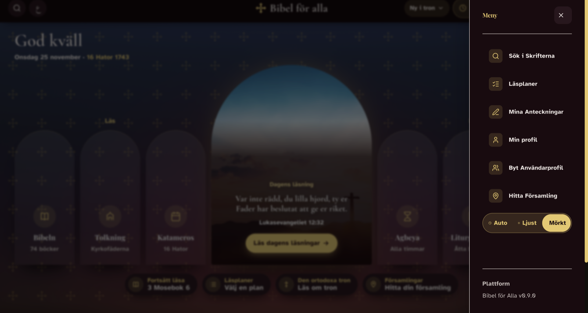
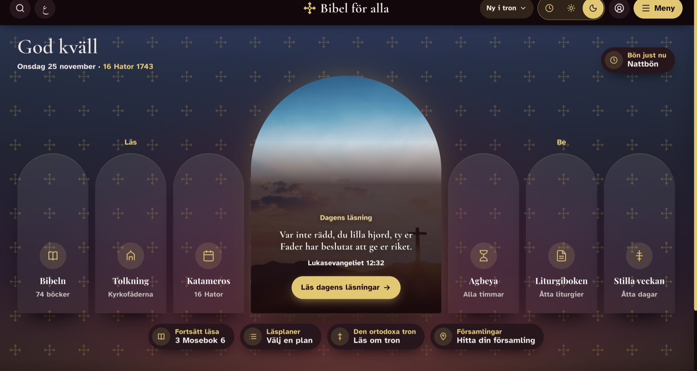
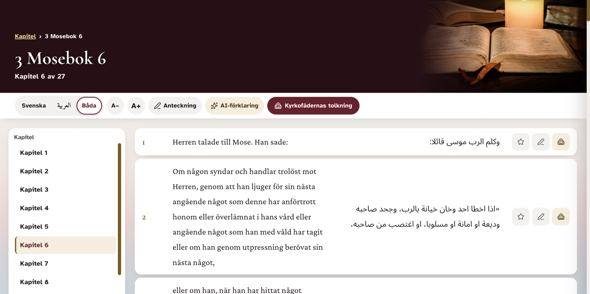
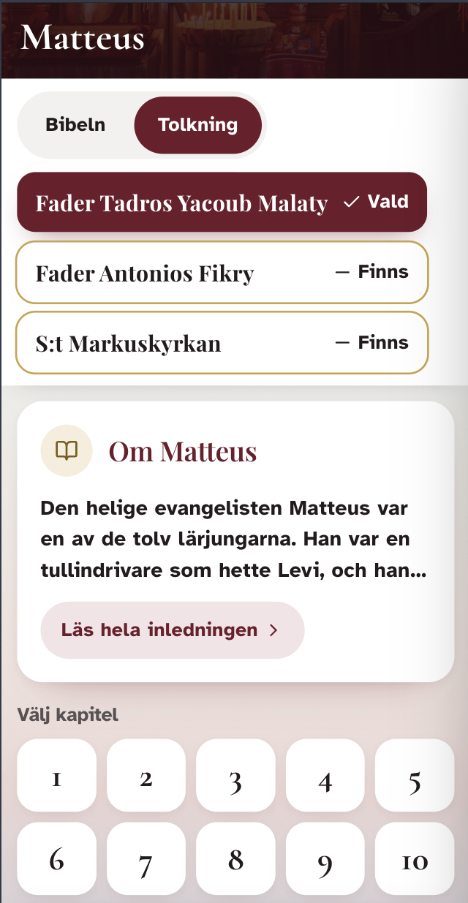
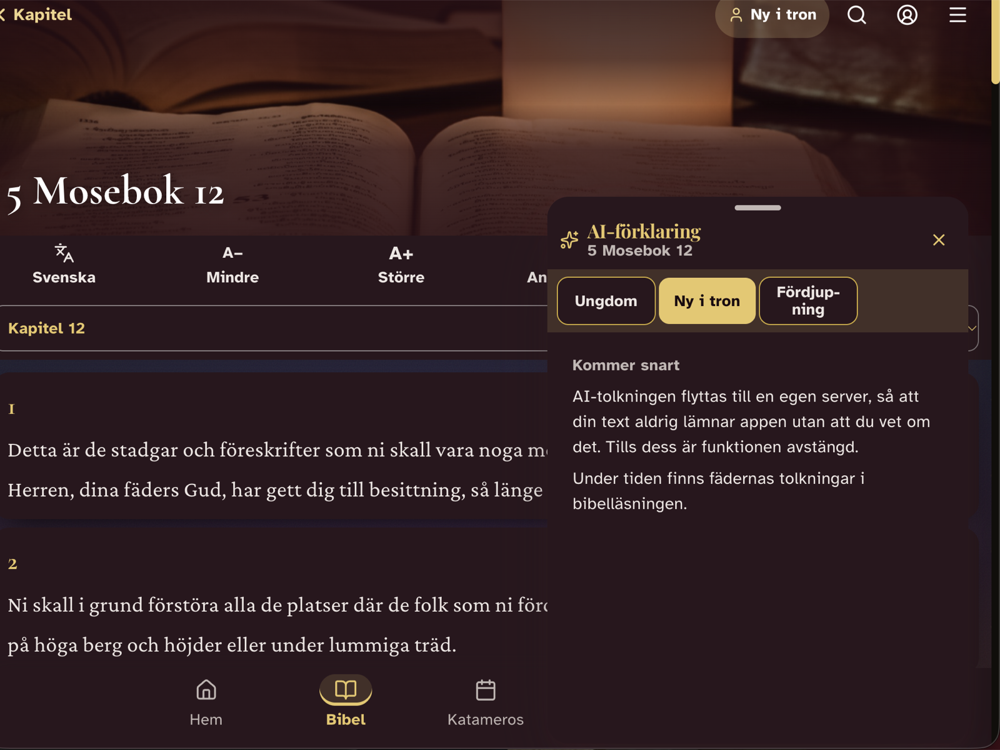
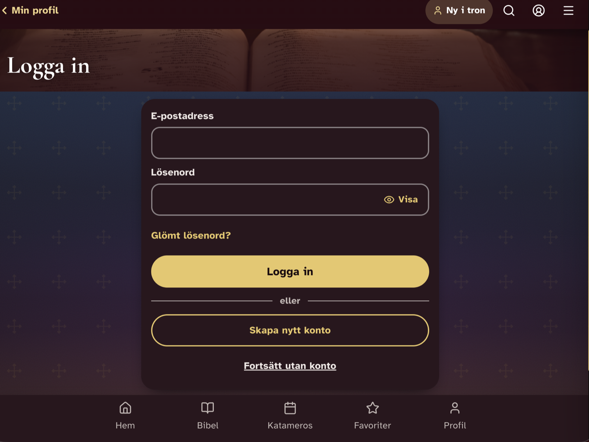

# 📖 Bibel-appen

Ett **digitalt kyrkobibliotek** på **svenska och arabiska** för koptisk-ortodoxa församlingar i Sverige, och för alla som är intresserade. Bibeln, kyrkofädernas tolkningar, bönböckerna, kyrkoåret och påven Shenouda III:s böcker på ett ställe.

> 🇬🇧 *A digital church library in Swedish and Arabic for Coptic Orthodox congregations in Sweden: the Bible, the Church Fathers' commentaries, prayer books, the church calendar and more. Read freely without an account, or sign in for personal features. React 19 frontend, a Node.js data pipeline with AI translation and human review, and security built in from the first line. The source code is private to protect the church's texts. I'm happy to walk you through it.*

**Byggd av:** Sima Soolind, fullstackstudent med säkerhetsinriktning · **Status:** Fas 1 (frontend) klar, Fas 2 (backend, konton och mobilapp) pågår

---

## Skärmbilder

**Startsidan:** biblioteket och dagens läsning enligt kyrkoåret

**Bibeln sida vid sida:** svenska och arabiska, två skriftriktningar

**Bön med ljud:** svenska och arabiska, och ljudet följer texten mening för mening

<table>
  <tr>
    <td width="33%" align="center"><b>Kyrkofädernas tolkning</b> tre verk att välja mellan</td>
    <td width="33%" align="center"><b>AI-förklaring</b> anpassad efter läsprofilen</td>
    <td width="33%" align="center"><b>Logga in</b> personliga funktioner med konto</td>
  </tr>
  <tr>
    <td align="center"></td>
    <td align="center"></td>
    <td align="center"></td>
  </tr>
</table>

---

## Problemet appen löser

Koptisk-ortodoxa församlingar i Sverige har ofta två språk i samma familj: föräldrar läser arabiska och barnen svenska. Bibeltexten, bönerna, kyrkoåret och kyrkofädernas tolkningar fanns inte samlade på ett ställe, på båda språken. Appen samlar hela biblioteket, fungerar utan internet och går att läsa utan konto.

---

## Biblioteket

**Den heliga skrift**
- **Bibeln** på svenska och arabiska, var för sig eller sida vid sida (35 781 verser), med tilläggsböckerna (apokryferna)

**Tolkning och undervisning**
- **Kyrkofädernas tolkning** kapitel för kapitel: tre verk som kan jämföras med ett tryck
- **Påven Shenouda III:s böcker** som läsplaner, dag för dag
- **Ortodox tro**: en introduktion för den som är ny

**Bön och gudstjänst**
- **Agbeya**, den koptiska bönboken, alla åtta bönetimmar
- **Liturgiboken** (kholagy) med åtta liturgier
- **Stilla veckan**, dag för dag
- **Ljud** för bönerna: 2 600+ ljudfiler som jag har skapat själv med text-to-speech

**Kyrkoåret**
- **Katameros**: dagens läsningar enligt kyrkoåret (395 dagar), med Synaxarium

**Församlingen**
- **Församlingskatalog** över kyrkor i Sverige

**AI-förklaring anpassad efter läsaren**
- En AI-ruta förklarar en vers. Läsaren väljer sin **läsprofil**, och förklaringen anpassas efter den: tre profiler: **Ungdom**, **Ny i tron** och **Fördjupning**
- Förklaringen bygger på **rätt källa**: kyrkofäderna i den koptiska traditionen, inte allmänna texter från internet
- Rutan är byggd i gränssnittet och kopplas på via servern i Fas 2, så att ingen API-nyckel finns i appen

**Verktyg**
- Sökning, ljust och mörkt läge, textstorlek, menyer på svenska eller arabiska, text från höger till vänster

---

## Med och utan konto

| Utan konto | Med konto |
|---|---|
| hela biblioteket, fritt | allt som finns utan konto, plus: |
| läsprofiler (ungdom, ny i tron, fördjupning) | **fortsätt läsa** där du slutade, på alla enheter |
| favoriter och anteckningar på enheten | favoriter och **krypterade anteckningar** sparade på kontot |
| | lästid, dagar i rad och böner du har läst eller lyssnat på |
| | läsplaner och andlig dagbok |
| | AI-förklaring av en vers, anpassad efter din läsprofil och med källor från kyrkofäderna |

Inloggningssidan är byggd. Konton öppnas i Fas 2 med Clerk, och kontots data sparas på servern.

---

## Teknik och varför

| Del | Val | Varför |
|---|---|---|
| Frontend | React 19, Vite, React Router | snabbt, komponenter som går att återanvända |
| Stil | egen CSS med gemensamma variabler | full kontroll över läsbarhet och arabisk text |
| Tillstånd | Context API | tema, språk, textstorlek och profil utan extra bibliotek |
| Data | PostgreSQL + egna Node-skript | städar, översätter och exporterar innehållet |
| AI | Gemini i batch | översätter tolkningarna från arabiska till svenska till låg kostnad |
| Ljud | text-to-speech | jag skapade ljudet för bönerna själv, så att alla kan lyssna |
| Backend (Fas 2) | Node.js, Express, TypeScript, Prisma, Zod | ett säkert API med typer och validering |
| Konton (Fas 2) | Clerk | säker inloggning utan att bygga lösenordshantering själv |
| Mobil (Fas 2) | Capacitor | samma kod blir app i App Store och Google Play |

---

## AI med människan som grind

Tolkningarna översätts av AI, men **ingen AI-text når läsarna utan granskning**:

1. AI översätter enligt fasta regler: trohet mot källan och kyrkans egna ord
2. Kodkontroller och en **andra AI** granskar och flaggar stycken
3. Jag granskar på sidan, tillsammans med kyrkan
4. Först när kyrkan har godkänt texten visas den för alla

Bygget stoppas automatiskt om ogranskad svensk text skulle hamna i appen.

---

## Säkerhet

Säkerheten byggs in från första raden (shift-left) och kontrolleras i lager:

| Lager | Kontroller |
|---|---|
| Före varje commit | lint med säkerhetsregler (SAST), 4 100+ tester, gitleaks (secret scanning) |
| GitHub Actions | lint, tester, bygget, `npm audit` (SCA) och gitleaks. Ett fel stoppar bygget |
| Data | egna databasroller med minsta behörighet, kostnadstak, inget sparas utan godkännande |
| Klienten | inga API-nycklar i webbläsaren, extern text renderas aldrig som HTML (skydd mot XSS) |
| Backend (Fas 2) | helmet, CORS, Zod, rate limiting, central felhantering, HTTPS |
| Konton (Fas 2) | användarens id tas från token, aldrig från anropet. Ingen kan läsa någon annans anteckningar |

Appen behandlar religiös övertygelse, en särskild kategori enligt **GDPR artikel 9**. Därför byggs konton med dataminimering, samtycke, kryptering av känsliga uppgifter och möjlighet att radera kontot i appen.

---

## Tillgänglighet

- Ingen text under 15 px, inga etiketter med bara versaler
- Tryckytor på minst 44 px
- Fungerar med skärmläsare och stor text (målet är WCAG 2.2 AA)

---

## Det jag har lärt mig

- Att bygga en riktig app för riktiga användare, med krav från en församling
- Att låta AI göra det tunga arbetet, men alltid med en människa som sista grind
- DevSecOps i praktiken: hotmodellering (STRIDE), automatiska säkerhetskontroller och små, granskade steg
- Att arbeta med två språk och två skriftriktningar i samma gränssnitt

---

## Nästa steg (Fas 2)

- Backend med Node.js, Express och TypeScript
- Konton med Clerk och kontots funktioner
- Mobilapp i App Store och Google Play

---

## 🔒 Koden är privat

Repot är privat för att skydda kyrkans texter och översättningarna under granskning. **Jag visar gärna koden och appen vid en intervju.**

📫 [Portfolio](https://sima-soolind.netlify.app)
